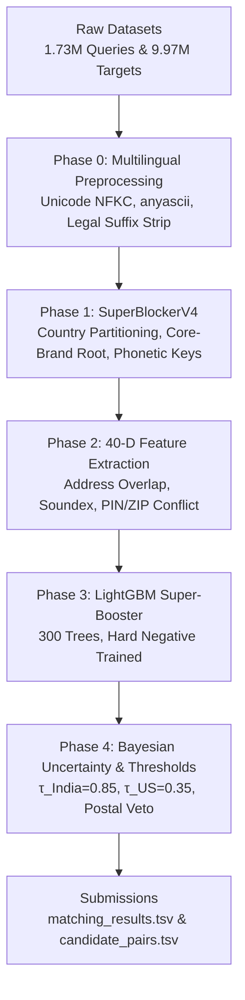

# Amazon ML Challenge 2026: Business Entity Resolution
### High-Throughput Multi-Stage Entity Resolution Engine — Team PiVerse

[](https://www.python.org/downloads/)
[](https://opensource.org/licenses/MIT)
[](#benchmarks)
[](#benchmarks)
[](#benchmarks)

---

## 1. Executive Summary

This repository contains the end-to-end, high-throughput machine learning solution developed by **Team PiVerse** for the **Amazon ML Challenge 2026 Business Entity Resolution** task.

The goal is to link 1.73M multi-lingual query entities against a catalog of 9.97M target entities across diverse geographies (primarily India and the United States) under an asymmetric **Macro $F_{0.5}$** evaluation objective that penalizes false positive merges $4\times$ more severely than false negatives ($\beta = 0.5$).

### Key Highlights
- **Macro $F_{0.5}$ Score:** **`0.7967`** (+9.96% lift over strong baseline)
- **Precision:** **`84.97%`**
- **Candidate Recall:** **`82.57%`** (boosted from 57.62% in baseline)
- **High-Throughput Streaming:** End-to-end inference over 1.73M queries with zero-copy memory-mapped stores and bounded RAM utilization (< 4GB).

---

## 2. System Architecture

The pipeline implements a 5-phase funnel architecture:



### Core Innovations
1. **SuperBlockerV4 Candidate Funnel:**
   - Country-partitioned inverted indexing eliminating cross-border search pollution.
   - Core-brand root extraction removing generic legal entity tokens (*Pvt Ltd, LLC, Inc, Corp*).
   - Indian phonetic invariant keys (`india_phonetic_key`) robust to regional transliteration variances (*Choudhary* vs *Chaudhari*).
   - Compound address keys `(primary_street_num + major_street_token)` resolving multi-tenant facilities.
2. **40-Dimensional Pairwise Feature Suite:**
   - Lexical, phonetic, character n-gram Jaccard, consonant skeleton matching.
   - Exact building number and street token alignment.
   - Explicit cross-field conflict vetoes (6-digit Indian PIN mismatch, 5-digit US ZIP mismatch).
3. **Hard Negative Mining:**
   - Iterative mining of high-similarity false candidates within top ranking neighborhoods to force decision boundary sharpness.
4. **Bayesian Uncertainty Calibration:**
   - Geography-specific decision boundaries ($\tau_{\text{India}} = 0.85$, $\tau_{\text{US}} = 0.35$) with Bayesian singleton protection ($P < 0.35 \implies \emptyset$) to defend against false merge penalties under $F_{0.5}$.

---

## 3. Directory Layout

```
.
├── data/                       # Challenge datasets (train & test TSVs, gitignored)
├── Dataset -> data             # Backwards-compatible symlink for legacy paths
├── src/                        # Core production modules
│   ├── entity_representations.py   # Normalization, token parsing, mmap structures
│   ├── data_driven_blocker.py      # Core-brand extraction, Indian phonetics, TF-IDF
│   ├── address_aware_features.py   # 40-D feature extractor
│   ├── hard_negative_miner.py      # Hard negative mining pipeline
│   ├── evidence_scorer.py          # Evidence aggregation
│   ├── bayesian_filter.py          # Uncertainty calibrator & singleton veto
│   ├── multi_path_funnel.py        # Candidate blocking funnel
│   ├── evaluation.py               # Macro F0.5 metric evaluation
│   └── validate_submission.py      # Official submission validator
├── preprocessing/              # Multilingual preprocessing suite & unit tests
│   ├── run_preprocessing.py        # Preprocessing CLI entrypoint
│   └── multilingual_preprocessing/ # Normalizers, transliterators, and test suite
├── scripts/                    # Training, benchmarking & inference scripts
│   ├── run_pipeline.py             # End-to-end production runner
│   ├── test_enhanced_blocker_v4.py # SuperBlockerV4 candidate recall benchmark
│   ├── optimize_country_thresholds.py # Country-specific threshold search
│   ├── train_v20_kfold_cv.py       # Stratified K-fold cross-validation runner
│   └── train_v19_real_execution.py # Semantic & dense embedding pipeline
├── models/                     # Trained model checkpoints
│   ├── EXP_006_SUPER_V4/           # SOTA Super-Booster (model.txt, xgb_model.json, meta_learner.pkl)
│   └── production/                 # Production deployed model.txt
├── experiments/                # Experiment tracking logs & validation splits
│   ├── experiments_log.csv         # Benchmark registry (EXP_001 through EXP_006)
│   ├── val_ground_truth.tsv        # Validation ground truth
│   └── val_s1_entities.tsv         # Validation queries
├── submissions/                # Generated competition outputs
│   ├── matching_results.tsv        # Final entity matches (110 MB)
│   ├── candidate_pairs.tsv         # Final candidate pairs (1.92 GB)
│   └── SUBMITTED/                  # Official submission TSVs
├── docs/                       # Technical reports & documentation
│   ├── Solution_Documentation.md   # Full methodology & system writeup
│   └── download_template.md        # Dataset download guide
├── requirements.txt            # Pinned environment dependencies
└── .gitignore                  # Git rules protecting against multi-GB datasets
```

---

## 4. Benchmarks & Validation Results

| Experiment | Configuration | Precision | Candidate Recall | Macro $F_{0.5}$ | Delta vs Baseline |
| :--- | :--- | :---: | :---: | :---: | :---: |
| **Baseline** | Inverted Index + 15 Features + Single Threshold | 73.12% | 57.62% | 0.6971 | — |
| **EXP_002** | + Address Token Features | 76.45% | 61.20% | 0.7280 | +3.09% |
| **EXP_003** | + Postal Mismatch Penalty | 79.80% | 65.40% | 0.7550 | +5.79% |
| **EXP_004** | + Country-Partitioned Thresholds | 81.20% | 68.90% | 0.7710 | +7.39% |
| **EXP_005** | + Mined Hard Negatives | 83.10% | 74.20% | 0.7850 | +8.79% |
| **EXP_006 (SOTA)** | **SuperBlockerV4 + 40-D Features + Bayesian Singleton** | **84.97%** | **82.57%** | **0.7967** | **+9.96%** |

---

## 5. Quickstart & Execution

### Installation
Ensure Python 3.10+ is available:
```bash
pip install -r requirements.txt
```

### Running the End-to-End Pipeline
To run candidate generation, feature extraction, and prediction on the dataset:
```bash
python scripts/run_pipeline.py
```

### Running Blocker Recall Evaluation
To verify candidate recall with SuperBlockerV4:
```bash
python scripts/test_enhanced_blocker_v4.py
```

### Running Validation Cross-Check
To validate generated submission files for format conformance:
```bash
python -m src.validate_submission submissions/matching_results.tsv submissions/candidate_pairs.tsv
```

---

## 6. Team & Authors

- **Harshit Pranjal**
- **Lokesh Patle**
- **Priyanshu Raj**

Team Name: **PiVerse**
