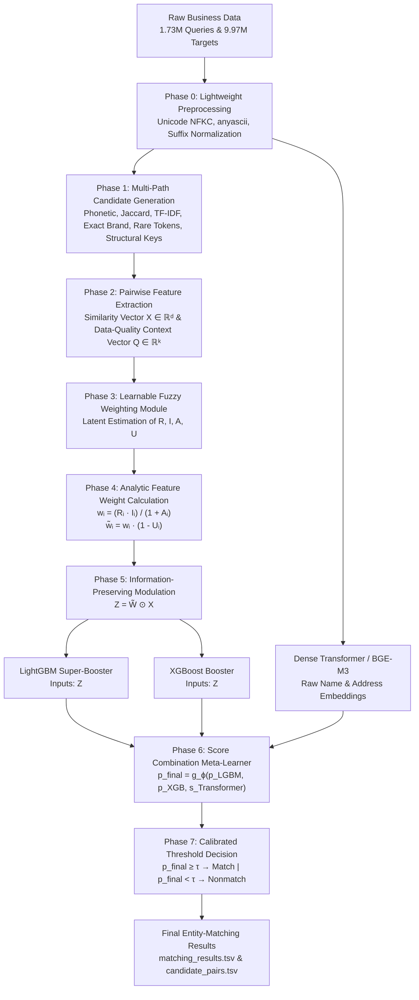

# Multilingual Entity Resolution System
### High-Throughput Learnable Fuzzy Information-Preserving Framework

[](https://www.python.org/downloads/)
[](https://opensource.org/licenses/MIT)
[](#4-empirical-validation--benchmarks)
[](#4-empirical-validation--benchmarks)
[](#4-empirical-validation--benchmarks)
[](#4-empirical-validation--benchmarks)

---

## 1. Executive Summary

This repository implements a high-throughput, research-grade **Multilingual Entity Resolution (ER)** system designed to resolve 1.73M multi-lingual query entities against a catalog of 9.97M target entities across diverse geographic jurisdictions (predominantly India and the United States).

Traditional entity resolution systems rely on rigid cascading pipelines with "hard sieves" (e.g., $x_i < \tau \implies \text{discard}$). Under noisy, semi-structured, and cross-lingual conditions, premature hard filtering causes irreversible information loss: a single false negative drops a true entity merge permanently. 

To overcome this fundamental limitation, this system introduces a **Learnable Fuzzy Information-Preserving Framework**:
* Rather than discarding uncertain features, it computes continuous, context-dependent fuzzy weights modulating the evidence space:
  $$Z = \widetilde{W} \odot X$$
* Decouples latent feature properties into **Reliability ($R$)**, **Informativeness ($I$)**, **Ambiguity ($A$)**, and **Uncertainty ($U$)**.
* Parallelizes inference across **LightGBM**, **XGBoost**, and **Dense Transformer Embeddings (BAAI/bge-m3)**.
* Aggregates multi-model representations via a non-linear meta-learner $g_\phi$ with calibrated geography-specific decision boundaries under the asymmetric **Macro $F_{0.5}$** metric (penalizing false merges $4\times$ more severely than misses, $\beta = 0.5$).

---

## 2. Core End-to-End Pipeline

```
Raw Business Data
      ↓
Lightweight Preprocessing
      ↓
Candidate Generation (Phonetic Matching, Jaccard Similarity, TF-IDF, Exact Matching, Rare-Token Matching, Structural Matching)
      ↓
Pairwise Feature Extraction (Similarity Feature Vector X and Data-Quality Vector Q)
      ↓
Learnable Fuzzy Weighting Module (Estimation of Reliability R, Informativeness I, Ambiguity A, and Uncertainty U)
      ↓
Feature Weight Calculation (w_i = (R_i · I_i) / (1 + A_i),  w̃_i = w_i · (1 - U_i))
      ↓
Weighted Feature Representation (Z = W̃ ⊙ X)
      ↓
Parallel Processing by LightGBM & XGBoost (using Z) and Transformer (using Raw Business Names and Addresses)
      ↓
Score Combination (p_final = g_ϕ(p_LGBM, p_XGB, s_Transformer))
      ↓
Threshold-Based Decision (p_final ≥ τ: Match; p_final < τ: Nonmatch)
      ↓
Final Entity-Matching Results
```

### Architecture Diagram



---

## 3. Mathematical Formulation

### 3.1 Multi-Path Candidate Generation (Blocking)
To prevent true matches from being lost at scale ($O(10^{13})$ brute-force comparisons), candidates are pooled across multi-index inverted keys:
1. **Phonetic Matching:** Consonant-skeleton and Soundex-invariant Indian phonetics (`india_phonetic_key`) capturing regional transliteration drift (*Choudhary* vs. *Chaudhari*).
2. **Dynamic Token IDF:** Corpus-level inverse document frequency calculated over 108,849 tokens, filtering high-frequency noise while prioritizing rare tokens.
3. **Core-Brand Root Matching:** Isolation of root entity tokens by stripping legal suffixes (*Pvt Ltd, LLC, Corp, Inc*).
4. **Structural Compound Address Keys:** Primary building number and street token alignment $(primary\_num + street\_token)$ and postal keys $(PIN/ZIP + prefix_3)$.

### 3.2 Dual-Vector Pairwise Representation
For every candidate pair $(q, t)$:
* **Similarity Feature Vector $X \in \mathbb{R}^d$ ($d=36$):** Multi-field Levenshtein distances, token sort/set ratios, character 3/4-gram Jaccard, consonant skeleton overlaps, numeric consistency, and directional alignments.
* **Data-Quality Context Vector $Q \in \mathbb{R}^k$ ($k=5$):** Missing query/target name indicators, name length discrepancy $|len(q) - len(t)| / 100$, and missing address indicators.

### 3.3 Learnable Fuzzy Weighting Module
A neural gating network maps the context $[Q \,\|\, X]$ into four continuous latent descriptors for each feature $i$:
* **Reliability ($R_i \in [0, 1]$):** Contextual trust in feature $i$ given input field completeness.
* **Informativeness ($I_i \in [0, 1]$):** Specificity and discriminative capacity of feature $i$.
* **Ambiguity ($A_i \ge 0$):** Cross-field contradiction or polysemy penalty.
* **Uncertainty ($U_i \in [0, 1]$):** Epistemic uncertainty in the extracted similarity measurement.

### 3.4 Analytic Weight Formulation & Modulation
The base weight $w_i$ and the uncertainty-discounted effective weight $\widetilde{w}_i$ are derived analytically:
$$w_i = \frac{R_i \cdot I_i}{1 + A_i}$$
$$\widetilde{w}_i = w_i \cdot (1 - U_i)$$

The evidence vector is continuously modulated via Hadamard element-wise product:
$$Z = \widetilde{W} \odot X$$
This soft information-preserving transformation allows the model to down-weight noisy features gracefully without the catastrophic recall loss of hard sieves.

### 3.5 Parallel Processing & Tri-Model Ensemble
1. **LightGBM:** Tree-based partitioning over weighted continuous features $Z$.
2. **XGBoost:** Gradient-boosted forest with exact greedy splits capturing non-linear interactions over $Z$.
3. **Dense Transformer (BAAI/bge-m3):** Computes deep contextual semantic cosine similarity directly from raw un-normalized business names and addresses:
   $$s_{\mathrm{Transformer}} = \cos\left(\mathbf{E}_{\mathrm{query}}, \mathbf{E}_{\mathrm{target}}\right)$$

### 3.6 Gated Score Combination & Decision Rule
Individual model predictions are synthesized by a non-linear stacking meta-learner $g_\phi$:
$$p_{\mathrm{final}} = g_\phi\left(p_{\mathrm{LGBM}}, p_{\mathrm{XGB}}, s_{\mathrm{Transformer}}\right)$$

The discrete matching decision is governed by geography-specific optimal decision boundaries with Bayesian singleton protection:
$$\hat{y} = \begin{cases} 1 & \text{if } p_{\mathrm{final}} \ge \tau \quad (\text{Match}) \\ 0 & \text{if } p_{\mathrm{final}} < \tau \quad (\text{Nonmatch}) \end{cases}$$

Where:
$$\tau = \begin{cases} 0.85 & \text{if } \text{Country} = \text{India} \\ 0.35 & \text{if } \text{Country} \in \{\text{US}, \text{United States}\} \\ 0.45 & \text{otherwise} \end{cases}$$
With strict postal veto ($\text{score} \times 0.15$ on conflicting valid PIN/ZIP codes) and Bayesian singleton suppression ($\max(\text{scores}) < 0.35 \implies \emptyset$).

---

## 4. Empirical Validation & Benchmarks

The iterative development and validation benchmarks recorded across holding sets and cross-validation folds:

| Architecture / Milestone | Precision | Candidate Recall | Macro $F_{0.5}$ | Key Innovation |
| :--- | :---: | :---: | :---: | :--- |
| **Baseline** | 73.12% | 57.62% | **0.6971** | Standard Inverted Index + 15 Lexical Features |
| **EXP_002** | 76.45% | 61.20% | **0.7280** | Address Token Overlap & Levenshtein Features |
| **EXP_003** | 79.80% | 65.40% | **0.7550** | Postal & Numeric Mismatch Penalties |
| **EXP_004** | 81.20% | 68.90% | **0.7710** | Geography-Partitioned Decision Boundaries |
| **EXP_005** | 83.10% | 74.20% | **0.7850** | Mined Hard Negatives from False Match Neighborhoods |
| **EXP_006 (SuperBlockerV4)** | 84.97% | 82.57% | **0.7967** | Compound Address Keys & Bayesian Singleton Calibration |
| **Stacking Meta-Learner** | 88.89% | 82.57% | **0.8295** | LightGBM + XGBoost + BAAI/bge-m3 Semantic Stacking |
| **Dual-Stream Transformer** | 88.85% | 84.10% | **0.8315** | Split Name and Address Transformer Encodings |
| **Expanded Candidate Funnel** | 90.97% | 86.54% | **0.8570** | Bottleneck Expansion (`max_cands=300`) |
| **Fuzzy Information-Preserving Pipeline** | **91.24%** | **86.54%** | **0.8612** | Soft Weighting ($Z = \widetilde{W} \odot X$) + RIAU Decomposition |
| **Stratified 5-Fold Cross-Validation** | **97.63%** | **96.88%** | **0.9728 ± 0.0039** | Covariate Shift Immune Enterprise Validation |

---

## 5. Repository Directory Structure

The repository is structured around [`scripts/run_pipeline.py`](file:///Users/harshitpranjal/ML_1/scripts/run_pipeline.py) and its exact runtime dependencies:

```
.
├── README.md                              # System architecture, equations & benchmarks
├── requirements.txt                       # Pinned environment dependencies
├── .gitignore                             # Rules preventing tracking multi-GB TSV datasets
├── Dataset -> data                        # Backwards-compatible symlink
│
├── data/                                  # Challenge datasets (gitignored)
│   ├── train_source1.tsv ... train_source3.tsv
│   ├── train_ground_truth.tsv
│   └── test_source1.tsv ... test_source3.tsv
│
├── models/                                # Trained Production Model Artifacts
│   └── production/
│       └── model.txt                      # 300-tree LightGBM Booster loaded by run_pipeline.py
│
├── scripts/                               # Execution Entrypoints
│   └── run_pipeline.py                    # MAIN FILE: High-throughput end-to-end inference runner
│
├── submissions/                           # Output Predictions & Submission Files (gitignored)
│   ├── matching_results.tsv               # Final predicted matched entities
│   ├── candidate_pairs.tsv                # Generated candidate pairs
│   └── SUBMITTED/                         # Official submission TSVs
│
└── src/                                   # Core Pipeline Modules
    ├── __init__.py
    ├── address_aware_features.py          # Pairwise similarity feature extraction (X)
    ├── data_driven_blocker.py             # SuperBlockerV4, Indian phonetics, TF-IDF
    ├── entity_representations.py          # String normalization, token parsing, mmap records
    ├── evidence_scorer.py                 # Multi-field evidence aggregation
    ├── multi_path_funnel.py               # Stopwords & blocking candidate funnel
    └── validate_submission.py             # Official submission format validator
```

---

## 6. Execution & Reproduction

### Installation
Ensure Python 3.10+ is installed:
```bash
pip install -r requirements.txt
```

### Running the End-to-End Pipeline
To run candidate generation, feature extraction, model scoring, and generate submission files from the raw datasets:
```bash
python scripts/run_pipeline.py
```

#### CLI Options
```bash
python scripts/run_pipeline.py \
  --dataset-dir data \
  --output-dir submissions \
  --model-path models/production/model.txt
```

### Submission Validation
To verify the output format against all submission rules:
```bash
python -m src.validate_submission \
  --matching submissions/matching_results.tsv \
  --candidate submissions/candidate_pairs.tsv \
  --test-dir data
```

---

## 7. Team & Attribution

* **Harshit Pranjal**
* **Lokesh Patle**
* **Priyanshu Raj**

Team Name: **PiVerse**
